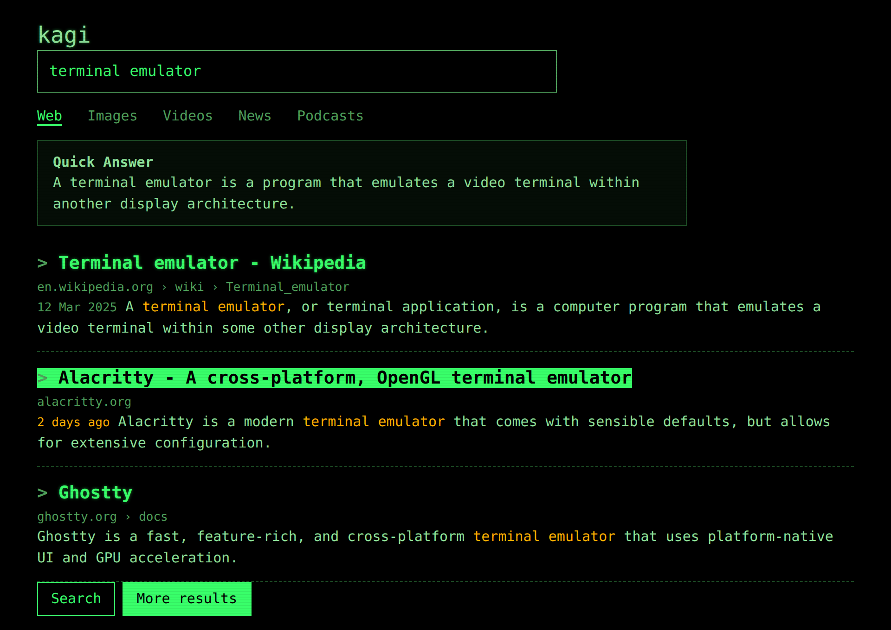

# Kagi Terminal

A green-on-black terminal theme for [Kagi Search](https://kagi.com), inspired by DuckDuckGo's Terminal theme.

## Install

Copy [`kagi-terminal.css`](https://raw.githubusercontent.com/JPain/kagi-terminal/main/kagi-terminal.css) into
**Kagi → Settings → Appearance → [Custom CSS](https://kagi.com/settings/custom_css)** and apply.

Amber and white palettes, the font and the effects can be switched at the top of the file.
Add `&no_css` to a search URL to turn the theme off temporarily.

MIT licence. Not affiliated with Kagi or DuckDuckGo.
